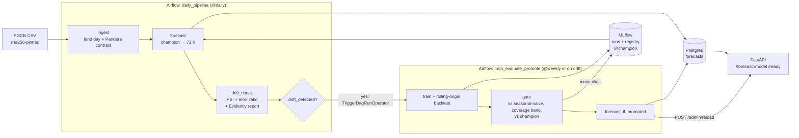

# Bangladesh Power Demand Forecasting MLOps Pipeline

**Forecasts Bangladesh's national hourly electricity demand 1–72 hours ahead, with a P10–P90 prediction interval, and keeps the model current by itself:** one daily Airflow DAG validates the new day's data, writes the forecast and checks for drift; when drift is detected it triggers a retraining DAG that backtests a challenger, logs it to MLflow and promotes it only if a gate says so. Served by FastAPI, packaged with Docker, deployable to Kubernetes with Helm.

Python · LightGBM · MLflow (tracking + registry) · Airflow 3 · Evidently · FastAPI · Postgres · Docker · Kubernetes (k3d / k3s) · Helm · Terraform (Oracle Cloud) · GitHub Actions

> **Data — all real.** Shekh & Rafi, *Hourly Electricity Generation, Demand, Load Shedding, and Fuel Mix Dataset for Bangladesh (2015–2026)*, Mendeley Data v1, [doi:10.17632/vpk8spw2mm.1](https://doi.org/10.17632/vpk8spw2mm.1), CC BY 4.0, compiled from the Power Grid Company of Bangladesh (PGCB) ERP portal. Downloaded by `powerfc fetch` and pinned by SHA-256. There is no live feed: the last 12 months are a **holdout replayed one day at a time** as "new" data.

---

## Why

Load-shedding is planned a day or more ahead, so operators need hourly demand forecasts with an honest range. Demand also *moves*: it grows about 5% a year, and Ramadan and Eid (lunar dates that shift ~11 days a year) and the hot season reshape it. A model trained once goes stale. This project is the system that notices and retrains — Google's MLOps **Level 1 (continuous training)**, with Level 2 pieces (CI/CD of the pipeline itself).

## Results

Measured 2026-10-10 with `make backtest` (`bench/full_backtest.py`, full run, 11 min 42 s on an Apple M4 laptop). Weekly forecast origins at 23:00 Dhaka time, rolling origin, models refit every 4 weeks on all data before the origin. sMAPE on demand; skill = 1 − model sMAPE ÷ seasonal-naive sMAPE ("same hour last week"). Coverage = share of actual hours inside the model's raw P10–P90 interval (nominal 80%; **no calibration is applied**).

**Final holdout — the last 12 months (origins 2025-03-09 → 2026-03-01), evaluated once, nothing tuned on it** (52 origins)

| Lead time | sMAPE | Seasonal-naive | Skill | MAE | P10–P90 coverage | Interval width | Holiday-window sMAPE |
|---|---|---|---|---|---|---|---|
| 1–24 h | **3.58%** | 6.32% | **43%** | 454 MW | 77.6% | 1,226 MW | 6.38% |
| 25–48 h | **5.10%** | 8.53% | **40%** | 640 MW | 74.6% | 1,605 MW | 8.56% |
| 49–72 h | **5.98%** | 8.51% | **30%** | 742 MW | 66.0% | 1,722 MW | 7.86% |

**Backtest — the two years before the holdout (origins 2023-03-12 → 2025-03-02)** (104 origins): sMAPE 4.25% / 5.49% / 6.64% vs naive 10.56% / 10.07% / 9.96% (skill 60% / 45% / 33%); P10–P90 coverage 68.3% / 65.6% / 61.2%. Full tables: [`bench/results/forecast_accuracy.md`](bench/results/forecast_accuracy.md).

What the numbers say:
- The model beats "same hour last week" at every horizon; the advantage shrinks with lead time, as it should.
- Holiday windows (public holidays and ±3 days around each Eid) are harder: their sMAPE is 1.4–2.1× that of normal days (`forecast_accuracy.json`).
- **The raw intervals are too narrow:** an "80%" interval covered 61–78% of actual hours. Read P10–P90 as roughly a 65–75% interval. The promotion gate's coverage band, [0.55, 0.92], was set from the 2-year backtest only, before the holdout was scored ([ADR 0009](docs/adr/0009-trim-for-defensibility.md)).

### The loop, closed on real data (re-run 2026-10-10, docker compose, Apple M4)

1. `make bootstrap` trained the first champion through Airflow (v1, gate decision "first").
2. 17 holdout days (2025-03-09 → 03-25: the end of Ramadan and the start of the hot season) went through `daily_pipeline`, 15–25 s per day. Drift is judged only on data the champion has not seen, after at least 7 days of it, so days 1–6 reported "waiting".
3. **2025-03-15:** `drift_check` reported PSI 8.27 (on the demand level) → `drift_detected` → `trigger_retrain` started `train_evaluate_promote` — no human involved. The challenger passed the gate as a **refresh** (sMAPE within 5% of the champion at every block) and became v3; the API reloaded it. Trigger → promoted and reloaded: **80 s**.
4. **2025-03-22** (last week of Ramadan): PSI 8.27 **and** an error ratio of 2.17 (v3's sMAPE 6.11% on 161 recent hours vs its backtest 2.81%) → second automatic retrain → v4 promoted as a refresh, API reloaded (75 s).
5. The gate also said no: a deliberately weak recipe (40 trees, 4 leaves) was **rejected** (24 h skill −0.34 vs seasonal-naive), and a manual retrain on data to 03-25 was **rejected** as a refresh (24 h sMAPE 2.55% → 3.86%: its window now included the run-up to Eid).

Every run is in MLflow (`powerfc-demand` and `powerfc-demand-monitoring`, with the Evidently report per check) and in Airflow's run history. Details: project changelog, 2026-10-10 "Trimmed" entry.

## Architecture



Each ML task is one function in `powerfc`, run in its own virtualenv (`@task.external_python`) so the ML stack never collides with Airflow's dependencies. The same functions run from the CLI, CI and Kubernetes CronJobs.

**On Kubernetes** (`deploy/helm/powerfc`): forecast API (startup/liveness/readiness probes, requests/limits), MLflow + Postgres (StatefulSet, PVCs), a bootstrap Job, and two CronJobs — daily `replay-next → forecast → drift`, weekly `train → promote → forecast → reload-api`. Airflow (and therefore the drift-triggered retrain) stays in compose: its image is ≈4.7 GB ([ADR 0005](docs/adr/0005-k3s-on-oci.md)). The chart runs on local k3d and, via `infra/terraform`, targets an Oracle Cloud Always Free ARM VM with k3s (written and `terraform validate`-clean; **not applied** — no Oracle account yet). After the trim the chart was linted and rendered (`helm lint`, `helm template`), not re-deployed.

## Run it

Needs Docker (≈9 GB of images) and [uv](https://docs.astral.sh/uv/).

```bash
make setup data            # install; download the PGCB CSV (sha256-checked) and build the clean table
make test                  # leakage, data contract, gate rules, drift rule, API
make up                    # Postgres, MLflow :5050, Airflow :8080 (admin/admin), API :8000/docs
make bootstrap             # train the first champion through Airflow, then switch the daily DAG on
make replay                # one day of daily_pipeline: next holdout day → forecast → drift → maybe retrain
make backtest              # re-measure the tables above (~12 min)
make k3d-up                # the Helm chart on local Kubernetes (needs k3d, helm, kubectl)
```

Repeat `make replay` to move forward in time; drift needs at least 7 replayed days after each champion's cut-off.

## What is tested

- **No leakage:** `tests/test_leakage.py` mutates every value after the cut-off and asserts the features do not change (and that mutating data *inside* the window does change them).
- **Data contract:** Pandera rejects broken scrapes (e.g. 20% of hours missing, negative load shedding) before anything trains.
- **Gate rules:** first model, improvement margin, refresh tolerance, coverage band, latency, unchanged models.
- **Drift rule:** PSI or error ratio alone triggers, thresholds are strict, PSI sanity, the current window holds only unseen data.
- **API:** horizons, 422 on a bad horizon, readiness, `/admin/reload`.
- **DAG structure** (`tests/test_dags.py`, needs Airflow): two DAGs, the daily steps wait for each other, drift triggers the retrain DAG.
- **CI** (`.github/workflows/ci.yml`): lint, tests, the real dataset through the contract, a train smoke test into MLflow, an **integration job** that boots Postgres + MLflow + API and serves a forecast, and a **model gate** that fails a pull request whose recipe does not beat the committed champion metrics on identical data and folds (`python -m powerfc.ci_gate`). `deliver.yml` builds amd64 + arm64 images to GHCR and runs `helm upgrade` on the node once it exists. *Not yet run on GitHub — the repository does not exist yet.*

## Data findings worth knowing

- `demand_mw` is **observed** demand: during load shedding it is capped by supply, so it is served, not latent, demand.
- **There is no 00:00 reading for any year since 2016**; most "missing" hours (5.2%) are midnights. They are interpolated for lag features only and never used as targets.
- Typos exist (e.g. 121,000 MW against a ~8,600 MW median); 221 hours are flagged and removed from the target, never silently deleted.
- Shedding happened in 16% of all hours, but ~58% of hours in 2023–24.

## Decisions

[`docs/adr/`](docs/adr/): rolling-origin backtesting · LightGBM quantile models · Airflow with an isolated venv · the promotion gate · k3s on Oracle instead of managed Kubernetes · MLflow-served artifacts (MinIO images were gone from Docker Hub) · PSI + error ratio as the retrain rule · **the 2026-10-10 trim** (synthetic stream, Prometheus/Alertmanager/Grafana, conformal calibration and a load-shedding risk score removed; daily DAGs merged — [ADR 0009](docs/adr/0009-trim-for-defensibility.md)). Kubeflow was considered, not used.

## MLOps Zoomcamp rubric (self-assessed)

| Criterion | Max | Evidence | Score |
|---|---|---|---|
| Problem description | 2 | This README | 2 |
| Cloud | 4 | Helm chart (ran on k3d before the trim); Terraform for OCI written and validated, **not applied** | 2 |
| Experiment tracking & registry | 4 | MLflow runs, aliases, gate tags | 4 |
| Workflow orchestration | 4 | Airflow DAGs run end to end in compose | 4 |
| Model deployment | 4 | Containerised API, Helm chart | 4 |
| Model monitoring | 4 | Evidently/PSI + error ratio → retrain DAG triggered by the daily DAG (conditional workflow) | 4 |
| Reproducibility | 4 | Makefile, uv.lock, sha256-pinned data, content-hashed data versions | 4 |
| Best practices | 7 | unit + integration tests, ruff, Makefile, CI/CD (no pre-commit hook yet) | 6 |

The cloud score becomes 4 once `terraform apply` runs on a real account.

## Cost

$0 locally. The cloud design targets $0/month on Oracle's Always Free tier (limits reported second-hand; check before applying).

## Layout

```
src/powerfc/   data (load, clean, contract, store) · features · models · evaluate · train · registry (gate) ·
               monitoring (drift + retrain rule) · serve (API, Postgres) · pipeline CLI · ci_gate
dags/          daily_pipeline, train_evaluate_promote     deploy/helm/powerfc   chart
infra/terraform  OCI A1 + k3s                           deploy/k3d            local cluster script
bench/         accuracy backtest + results              tests/                unit tests (+ DAG test)
docs/          ADRs, MEMORY.md                          
```

## Author

Built by **Juthy** — B.Sc. (Hons.) in Information and Communication Technology, Institute of Information Technology, Jahangirnagar University.
